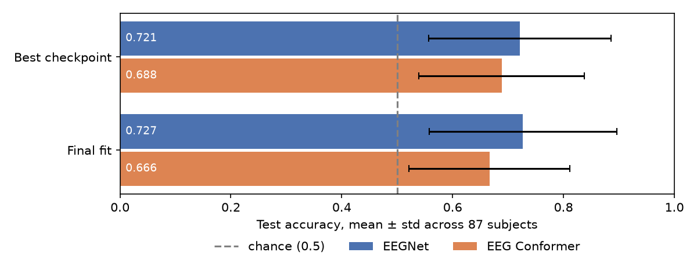
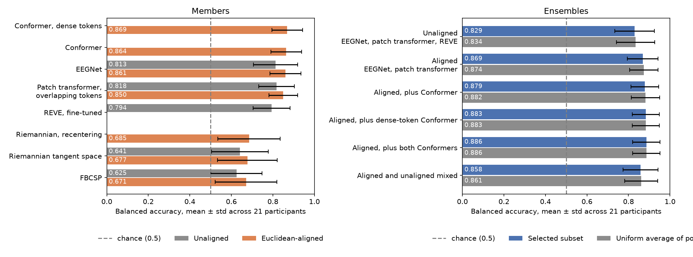
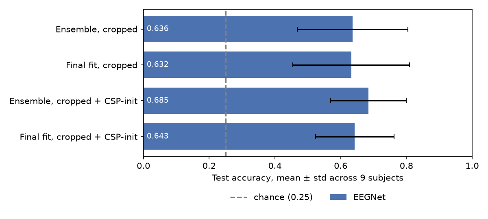
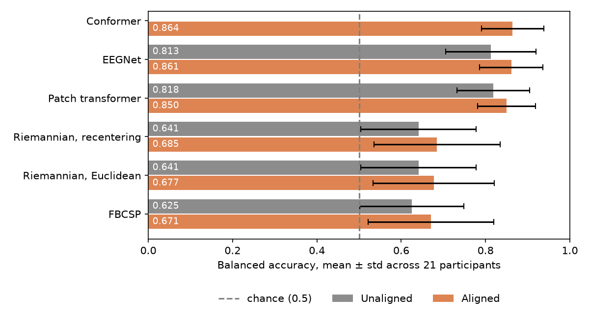
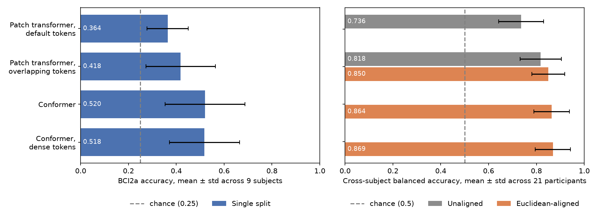

# EEG Motor Imagery Decoding: EEGNet and EEG Conformer

Motor imagery decoding across two public EEG datasets: Dreyer 2023 [5] and BCI
Competition IV Dataset 2a [3]. Compares EEGNet [1], a standard lightweight CNN
baseline for this task, against the EEG Conformer [2], a convolution module
followed by a transformer encoder. A cross-subject setting on Dreyer2023 adds a
patch transformer, Riemannian tangent-space [7] and filter-bank CSP [8]
classifiers, a fine-tuned REVE [6], per-participant Euclidean alignment [9] and
overlapping time-based tokenization for the transformer members.

This project's benchmark submission to the NeurIPS 2026 EEG/EMG Foundation
Challenge is documented separately, in
[README_NEURIPS2026.md](README_NEURIPS2026.md).

## Task

Each dataset poses a different generalization shift (within-session holdout,
cross-subject, or cross-session); see `datasets.py` for the exact preset (class
count, channel count, sampling rate, subject list, split strategy) backing each
one below. In every setting, train and validation data are drawn only from the
training portion. The test portion is held out entirely until final scoring and
never touched during model or hyperparameter selection.

### Dreyer2023

2-class right/left hand motor imagery, 87 subjects, 27 EEG channels (plus
EMG/EOG, unused here) at 512 Hz native, single session per subject (6 runs: 2
calibration + 4 online-feedback) [5].

#### Per subject

Models are trained and evaluated per subject. With no second session to hold
out, the split takes a trailing, per-class-stratified 20% of that session's
trials as the test set (see `within_session_holdout` in `data_loader.py`).

#### Cross-subject

The same corpus with whole participants held out. Participants 61 to 81 (21
participants, 240 balanced trials each) form the test set. Of the remaining 66,
14 are drawn whole as validation participants (`random_state=33`) and 52 are
fitting participants. Models are fitted on pooled participants, so no test
participant contributes a trial or a label to training.

### BCI2a

Subjects imagine a movement (left hand, right hand, feet, or tongue) without
actually moving it; the task is decoding which one from EEG alone. 9 subjects,
22 channels, 288 trials in each of two recorded sessions (`0train`, `1test`),
recorded by the Institute for Knowledge Discovery (Laboratory of Brain-Computer
Interfaces), Graz University of Technology, for BCI Competition IV [3]. Models
are trained and evaluated per subject, using the dataset's original session
split rather than a random one, so results are directly comparable to published
baselines rather than to an arbitrary held-out slice.

## Results

### Dreyer2023

#### Per subject

| | Accuracy | Kappa |
|---|---|---|
| EEGNet, best checkpoint (single 80/20 split) | 0.721 ± 0.164 | 0.443 ± 0.328 |
| EEGNet, final-fit (100% of session, held-out tail excluded) | 0.727 ± 0.170 | 0.454 ± 0.339 |
| Conformer, best checkpoint (single 80/20 split) | 0.688 ± 0.149 | 0.377 ± 0.299 |
| Conformer, final-fit (100% of session, held-out tail excluded) | 0.666 ± 0.145 | 0.333 ± 0.290 |



Mean ± std across all 87 subjects (sample std), default hyperparameters, no
cropped training. The paired per-subject accuracy difference, EEGNet minus
Conformer, is +0.033 ± 0.020 for the best checkpoint (EEGNet ahead on 44
subjects, Conformer on 37, 6 ties) and +0.061 ± 0.019 for the final fit (55, 26,
6), mean ± standard error.

#### Cross-subject

Balanced accuracy on the 21 test participants, mean ± std across participants.
Aligned columns use the alignment described under
[Alignment](#alignment). Members with a named tokenizer are described under
[Tokenization](#tokenization).

| Member | Unaligned | Aligned |
|---|---|---|
| EEG Conformer [2], dense tokens | not run | 0.869 ± 0.074 |
| EEG Conformer | not run | 0.864 ± 0.074 |
| EEGNet [1] | 0.813 ± 0.107 | 0.861 ± 0.075 |
| Patch transformer, overlapping tokens | 0.818 ± 0.086 | 0.850 ± 0.069 |
| REVE [6], fine-tuned on pooled participants | 0.794 ± 0.089 | not run |
| Riemannian tangent space [7] | 0.641 ± 0.137 | 0.677 ± 0.144 |
| Riemannian tangent space, Riemannian recentering [10] | not applicable | 0.685 ± 0.150 |
| FBCSP [8] | 0.625 ± 0.123 | 0.671 ± 0.149 |

Ensembles average member probabilities uniformly. The subset is chosen on
validation negative log-likelihood and shared by all test participants:

| Pool | Selected subset | Selected | Uniform average of the pool |
|---|---|---|---|
| Unaligned: EEGNet, patch transformer, REVE, Riemannian, FBCSP | EEGNet + patch transformer + REVE | 0.829 ± 0.095 | 0.834 ± 0.092 |
| Aligned: EEGNet, patch transformer, Riemannian, FBCSP | EEGNet + patch transformer | 0.869 ± 0.074 | 0.874 ± 0.069 |
| Aligned: the four above plus the Conformer | EEGNet + patch transformer + Conformer | 0.879 ± 0.067 | 0.882 ± 0.068 |
| Aligned: EEGNet, patch transformer, dense-token Conformer | all three | 0.883 ± 0.065 | 0.883 ± 0.065 |
| Aligned: EEGNet, patch transformer, both Conformers | all four | 0.886 ± 0.066 | 0.886 ± 0.066 |
| Aligned and unaligned versions of the four members, plus REVE | EEGNet, patch transformer, unaligned EEGNet, REVE | 0.858 ± 0.084 | 0.861 ± 0.080 |



The selected aligned ensemble with the Conformer exceeds aligned EEGNet alone by
+0.0185 ± 0.0058 balanced accuracy (better on 14 of 21 participants). Shifting
each participant's decision threshold to the median of that participant's
scores adds 0.007 to it (0.886).

### BCI2a

| | Accuracy | Kappa |
|---|---|---|
| EEGNet, ensemble (5-fold, cropped training) | 0.636 ± 0.168 | 0.525 ± 0.222 |
| EEGNet, final-fit (100% of train session, cropped) | 0.632 ± 0.177 | 0.506 ± 0.224 |
| EEGNet, ensemble (5-fold, cropped + CSP-init) | 0.685 ± 0.115 | 0.580 ± 0.154 |
| EEGNet, final-fit (cropped + CSP-init) | 0.643 ± 0.119 | 0.524 ± 0.159 |



Mean ± std across the 9 subjects (sample std). Both ensemble numbers sit in the
range reported for this exact architecture and dataset in the published
literature [1] (roughly 63-72% accuracy, κ≈0.5-0.6).

## Methodology

- **Preprocessing**: 4-38 Hz bandpass, resampled to 250 Hz, per-channel z-score
  normalization fit on the training session only.
- **Validation**: single 80/20 split or stratified k-fold, selectable per run.
  Hyperparameters are selected via k-fold rather than a single split.
  The cross-subject results report balanced accuracy and AUROC per participant
  instead.
- **Cropped training**: trials are sliced into overlapping windows as training
  augmentation, loosely following [4]; evaluation crops test trials the same way and
  averages predictions per trial.
- **Cross-subject fitting**: each member is fitted on pooled participants. Test
  probabilities come from a fit on all 66 training participants. Validation
  probabilities come from a fit on the 52 fitting participants only, so
  ensemble selection never sees validation labels. Trials are epoched 0 to 4 s
  after the cue, 4 to 38 Hz, 250 Hz (200 Hz for REVE), and each participant is
  z-scored per channel with that participant's own statistics.
- **Ensemble selection**: members are averaged uniformly. The subset with the
  best validation negative log-likelihood is scored on the test participants,
  with paired standard errors over participants.
- **Reporting**: accuracy and Cohen's kappa, mean ± std across subjects, not a single
  headline number. For k-fold runs, three numbers are computed: the plain average of
  each fold model's own score, an ensemble score (averaging the fold models'
  predictions, not their scores; these are not the same thing, and the ensemble is
  consistently the stronger of the two), and a final model retrained on the full
  training session using a step-matched epoch budget from cross-validation.
- **Reproducibility**: model initialization and data shuffling are seeded per
  subject, so repeat runs with identical config are exactly reproducible.

### Alignment

Per-participant alignment removes participant-specific covariance structure
before fitting. Euclidean alignment [9] whitens each participant's trials with
the inverse square root of that participant's mean trial covariance. Riemannian
recentering [10] moves each participant's covariance matrices to the identity
at their Riemannian mean and applies to the tangent-space member only.

Alignment is configured by `data.alignment` (`none`, `euclidean` or
`riemannian`) and `data.alignment_n_trials` (0 uses every trial). The statistic
comes from each participant's own unlabeled trials, never pooled across
participants and never from labels. It is applied to fitting, validation and
test participants alike, after the cached raw epochs are loaded.

Balanced accuracy on the 21 cross-subject test participants. The gain is the
paired difference, aligned minus unaligned, mean ± standard error:

| Member | Unaligned | Aligned | Gain |
|---|---|---|---|
| EEGNet | 0.813 ± 0.107 | 0.861 ± 0.075 | +0.048 ± 0.012 |
| Patch transformer, overlapping tokens | 0.818 ± 0.086 | 0.850 ± 0.069 | +0.032 ± 0.009 |
| EEG Conformer | not run | 0.864 ± 0.074 | not applicable |
| Riemannian tangent space, Euclidean | 0.641 ± 0.137 | 0.677 ± 0.144 | +0.036 ± 0.017 |
| Riemannian tangent space, Riemannian recentering | 0.641 ± 0.137 | 0.685 ± 0.150 | +0.043 ± 0.018 |
| FBCSP | 0.625 ± 0.123 | 0.671 ± 0.149 | +0.046 ± 0.014 |



### Tokenization

Both transformer members turn a trial into a sequence of tokens with a
convolution. Token size and stride are set in milliseconds and converted to
samples at `data.resample_freq`, so one setting carries across sampling rates.

- **Patch transformer**: the default tokenizer cuts non-overlapping patches of
  25 samples, 40 tokens per 4 s trial at 250 Hz. The overlapping tokenizer
  (`patch_size_ms`, `patch_stride_ms`) cuts 100 ms patches at a 40 ms stride,
  98 tokens.
- **EEG Conformer**: the convolution module is followed by average pooling
  that sets the token rate. The default is a 100 ms kernel with a 300 ms
  pooling window at a 60 ms stride, 61 tokens. The dense tokenizer
  (`kernel_length_ms`, `pool_size_ms`, `pool_stride_ms`) shortens the pooling
  window to 200 ms and the stride to 40 ms, 94 tokens.

BCI2a is a single split, best checkpoint, accuracy across 9 subjects.
Cross-subject is balanced accuracy across the 21 test participants.

| Member | Tokens | BCI2a | Cross-subject, unaligned | Cross-subject, aligned |
|---|---|---|---|---|
| Patch transformer, default tokens | 40 | 0.364 ± 0.086 | 0.736 ± 0.094 | not run |
| Patch transformer, overlapping tokens | 98 | 0.418 ± 0.145 | 0.818 ± 0.086 | 0.850 ± 0.069 |
| EEG Conformer | 61 | 0.520 ± 0.167 | not run | 0.864 ± 0.074 |
| EEG Conformer, dense tokens | 94 | 0.518 ± 0.147 | not run | 0.869 ± 0.074 |



## Repository structure

```
configs/                YAML override files for --config
data/                   raw input only (MOABB/MNE cache)
output/                 results and figures
  {dataset}/            manifests, results, and summary JSON
    checkpoints/        .pt model checkpoints
    cross_subject/      probability dumps of the cross-subject members
  figures/              figures embedded in this README
src/                    pipeline code
  models/               architectures
scripts/                Colab CLI wrappers and figure generation
```

### `configs/`

- `patch_overlap.yaml`: overlapping tokenizer for the patch transformer.
- `conformer_dense.yaml`: dense tokenizer for the Conformer.
- `one_subject.yaml`, `ten_subjects.yaml`, `thirty_subjects.yaml`,
  `subjects_31_50.yaml`: subject subsets.

### `src/`

- `config.py`: hyperparameter dataclasses, config building and override logic.
- `datasets.py`: per-dataset presets (class and channel count, sampling rate,
  subject list, session-split strategy) and MOABB dataset classes.
- `data_loader.py`: MOABB/MNE loading, train/test split, normalization,
  cropping, alignment.
- `moabb_downloads.py`: MOABB download configuration (verified HTTPS, OSF
  redirect, retries).
- `download_dataset.py`: download-only fetch of a dataset's per-subject files.
- `csp_init.py`: CSP-based initialization of EEGNet's spatial filters.
- `train.py`: trains and checkpoints. Never touches test data.
- `evaluate.py`: scores saved checkpoints on the held-out test data.
- `sweep.py`: hyperparameter search, single-split or k-fold.
- `pretrain_trunk.py`: shared-trunk pretraining (see
  [README_NEURIPS2026.md](README_NEURIPS2026.md)).
- `cross_subject_members.py`: EEGNet, Conformer, patch transformer, Riemannian
  and FBCSP members fitted on pooled participants, writing probability dumps.
- `riemann_member.py`: tangent-space classifier with optional recentering.
- `fbcsp_member.py`: filter-bank CSP classifier.
- `reve_cross_subject.py`: REVE fine-tuned on pooled participants.
- `reve_embeddings.py`, `reve_member.py`, `reve_finetune.py`: per-subject REVE
  members (frozen embeddings with logistic regression, and fine-tuning).
- `dump_predictions.py`: per-trial softmax probabilities from saved per-subject
  checkpoints.
- `ensemble_harness.py`: member subset selection on validation participants,
  scored on test participants.
- `analyze_ensemble.py`: softmax-average ensemble against its best single
  member.

### `src/models/`

- `eegnet.py`: CNN baseline.
- `conformer.py`: EEG Conformer, convolution module plus transformer encoder.
- `patch_transformer.py`: convolutional patch tokens plus transformer encoder.

### `scripts/`

- `make_results_figure.py`: regenerates the figures in `output/figures/`.
- `setup_colab_cli.sh`: installs the Colab CLI.
- `colab_*.sh`: Colab wrappers, one per `src/` entry point (train, evaluate,
  cross-subject members, REVE members, dataset download, trunk pretraining),
  plus `colab_sync.sh` for uploading `src/` and the data cache.

## Usage

Run everything from inside `src/`. Requires `pip install -r requirements.txt`; a GPU
runtime (Colab or similar) is assumed for anything beyond a quick smoke test.

All three scripts below accept the same dataset-selection flags:
```
--dataset {bci2a,dreyer2023}      (default: bci2a)
--config path/to/overrides.yaml   (optional)
--set section.field=value         (repeatable, optional)
```
`--dataset` picks a preset from `datasets.py` (class count, channel count, sampling
rate, subject list, session-split strategy). `bci2a` is the dataset used for the
BCI2a Results above, and `dreyer2023` provides the Dreyer2023 Results.
`--config` loads a YAML file of overrides, nested by section, e.g.:
```yaml
train:
  lr: 0.001
eegnet:
  dropout: 0.3
data:
  n_train_sessions: 6
```
`--set` overrides a single field the same way from the command line, e.g.
`--set eegnet.dropout=0.3`; `--set` wins over `--config` on conflicts. A bare key with
no section (e.g. `--set lr=0.001`) resolves against `train`, then the model being run.

Train:
```
python train.py {eegnet,conformer} [--n-folds N] [--cropped] [--csp-init] [--pretrain] [dataset flags]
```
`--n-folds` defaults to 1 (single 80/20 split); any value ≥2 runs stratified k-fold,
producing one checkpoint per fold plus a final model retrained on the full training
data. `--cropped` enables crop-based training/evaluation, sized from `resample_freq`
so it scales correctly across datasets. `--csp-init` initializes EEGNet's spatial
filters from per-subject CSP components instead of random weights (EEGNet only).
Writes `output/{dataset}/{model}_checkpoints.json`, including which dataset produced
it.

Evaluate:
```
python evaluate.py {eegnet,conformer} [...] [dataset flags]
```
Loads the checkpoint manifest written by `train.py` for the selected `--dataset`,
scores every checkpoint on the held-out test data, prints per-subject and aggregate
metrics, and writes `output/{dataset}/{model}_results.json` and
`output/{dataset}/summary.json`. Passing a `--dataset`/`--config`/`--set` that doesn't
match what a checkpoint was trained with (per its manifest entry) raises immediately
rather than silently scoring against the wrong setup.

Sweep:
```
python sweep.py {eegnet,conformer} [--n-folds N] [dataset flags]
```
Grid search over a small `lr`/`dropout` grid (edit `DEFAULT_GRIDS` in `sweep.py` to
change it), evaluated via k-fold by default, on top of the chosen dataset/config
baseline. Writes `output/{dataset}/{model}_sweep.json`, sorted best first. Does not
modify any file. Applying a sweep result as the new default means adding it to
`datasets.py`'s preset or passing it via `--set`/`--config` on subsequent runs.

Cross-subject members and ensembles (Dreyer2023, participants 61 to 81 held
out; the first run epochs every participant and caches the result):
```
python cross_subject_members.py riemann fbcsp --dataset dreyer2023
python cross_subject_members.py riemann fbcsp --dataset dreyer2023 --set data.alignment=euclidean
python ensemble_harness.py eegnet_ea patch_transformer_ea conformer_ea --dataset dreyer2023/cross_subject --metric bal_acc
```
Dumps are written to `output/dreyer2023/cross_subject/`, with `_ea` appended
to the name for Euclidean alignment and `_ra` for Riemannian recentering (plus
`_n64` when `data.alignment_n_trials=64`). The pooled fits need about 8 GB of
memory. The neural members and REVE run on a Colab A100, which downloads the
dump and stops the session:
```
scripts/colab_cross_subject_members.sh -s SESSION --gpu A100 --dataset dreyer2023 --members eegnet --set data.alignment=euclidean --suffix _ea
scripts/colab_cross_subject_members.sh -s SESSION --gpu A100 --dataset dreyer2023 --members patch_transformer --config patch_overlap.yaml
scripts/colab_cross_subject_members.sh -s SESSION --gpu A100 --dataset dreyer2023 --members conformer --config conformer_dense.yaml --set data.alignment=euclidean --suffix _ea
scripts/colab_reve_cross_subject.sh -s SESSION --gpu A100 --dataset dreyer2023
```
The dump name does not encode the config, so a dump from a non-default config is
renamed after download (the 94-token Conformer is `predictions_conformer_dense_ea.npz`).

### Running on Colab

`scripts/` wraps the [Colab CLI](https://github.com/googlecolab/google-colab-cli) so
training runs on a Colab GPU while editing files as usual, without syncing to Drive
or copying into a notebook.

One-time setup:
```
scripts/setup_colab_cli.sh
```
Installs the CLI into `.venv`, pinning `jupyter_kernel_client==0.15.0`.

Authenticate once:
```
.venv/bin/colab sessions
```

Train on a GPU session (`trainer` is an example session name; any name works):
```
scripts/colab_train.sh -s trainer --gpu T4 -- eegnet --n-folds 5
```
Creates the session if it does not already exist (`--gpu` accepts `T4`, `L4`, `G4`,
`H100`, `A100`, or is omitted for a CPU session), uploads `src/`, installs
`requirements.txt`, runs `train.py` with everything after `--` forwarded as its
arguments, and downloads `output/` back on completion. `data/` is not uploaded;
MOABB downloads into Drive, so a dataset fetched once is reused by every later
session. `--script NAME` runs another `src/` entry point (e.g. `sweep.py`) instead
of `train.py`. Pass `--skip-sync` to skip the upload and install steps on a
session already set up this way.

Download a dataset on a CPU-only session before a GPU run:
```
scripts/colab_download.sh -s downloader -- dreyer2023
```
Runs `download_dataset.py` without a GPU, so no accelerator sits idle during the
transfer, and a failed download cannot abort a training run. Downloads retry on
timeouts and rate limits.

`scripts/colab_sync.sh -s trainer` uploads `src/` on its own; `--data` also uploads the
local `data/` cache to the Drive data directory that the pipeline scripts read
from, so a dataset present only locally is a cache hit on the next run.

Stop the session when done:
```
.venv/bin/colab stop -s trainer
```


## References

1. V. J. Lawhern, A. J. Solon, N. R. Waytowich, S. M. Gordon, C. P. Hung, and B. J.
   Lance, "EEGNet: A compact convolutional neural network for EEG-based
   brain-computer interfaces," *Journal of Neural Engineering*, vol. 15, no. 5,
   p. 056013, 2018.
2. Y. Song, Q. Zheng, B. Liu, and X. Gao, "EEG Conformer: Convolutional transformer
   for EEG decoding and visualization," *IEEE Transactions on Neural Systems and
   Rehabilitation Engineering*, vol. 31, pp. 710-719, 2023.
3. C. Brunner, R. Leeb, G. Müller-Putz, A. Schlögl, and G. Pfurtscheller, "BCI
   Competition 2008 - Graz data set A," 2008.
   [Dataset description](https://www.bbci.de/competition/iv/desc_2a.pdf) ·
   [competition page](https://www.bbci.de/competition/iv/).
4. R. T. Schirrmeister, J. T. Springenberg, L. D. J. Fiederer, M. Glasstetter,
   K. Eggensperger, M. Tangermann, F. Hutter, W. Burgard, and T. Ball, "Deep
   learning with convolutional neural networks for EEG decoding and
   visualization," *Human Brain Mapping*, vol. 38, no. 11, pp. 5391-5420, 2017.
5. P. Dreyer, A. Roc, L. Pillette, S. Rimbert, and F. Lotte, "A large EEG database
   with users' profile information for motor imagery brain-computer interface
   research," *Scientific Data*, vol. 10, p. 580, 2023.
   [DOI: 10.1038/s41597-023-02445-z](https://doi.org/10.1038/s41597-023-02445-z).
6. Y. El Ouahidi, J. Lys, P. Thölke, N. Farrugia, B. Pasdeloup, V. Gripon,
   K. Jerbi, and G. Lioi, "REVE: A foundation model for EEG, adapting to any
   setup with large-scale pretraining on 25,000 subjects," in *Advances in
   Neural Information Processing Systems 38 (NeurIPS 2025)*, 2025.
7. A. Barachant, S. Bonnet, M. Congedo, and C. Jutten, "Multiclass
   brain-computer interface classification by Riemannian geometry," *IEEE
   Transactions on Biomedical Engineering*, vol. 59, no. 4, pp. 920-928, 2012.
8. K. K. Ang, Z. Y. Chin, H. Zhang, and C. Guan, "Filter bank common spatial
   pattern (FBCSP) in brain-computer interface," in *Proc. IEEE International
   Joint Conference on Neural Networks (IJCNN)*, pp. 2390-2397, 2008.
9. H. He and D. Wu, "Transfer learning for brain-computer interfaces: A
   Euclidean space data alignment approach," *IEEE Transactions on Biomedical
   Engineering*, vol. 67, no. 2, pp. 399-410, 2020.
10. P. Zanini, M. Congedo, C. Jutten, S. Said, and Y. Berthoumieu, "Transfer
    learning: A Riemannian geometry framework with applications to
    brain-computer interfaces," *IEEE Transactions on Biomedical Engineering*,
    vol. 65, no. 5, pp. 1107-1116, 2018.


## Limitations

The Dreyer2023 per-subject results use a within-session holdout, so they
measure generalization to later trials of the same session, not to a new day.
Conformer hyperparameters are the original paper's defaults. A learning-rate
and dropout grid on subjects 1-10 left validation accuracy within one point
across all four settings. Each cross-subject member has one seed, so the
intervals cover variation across participants only.
